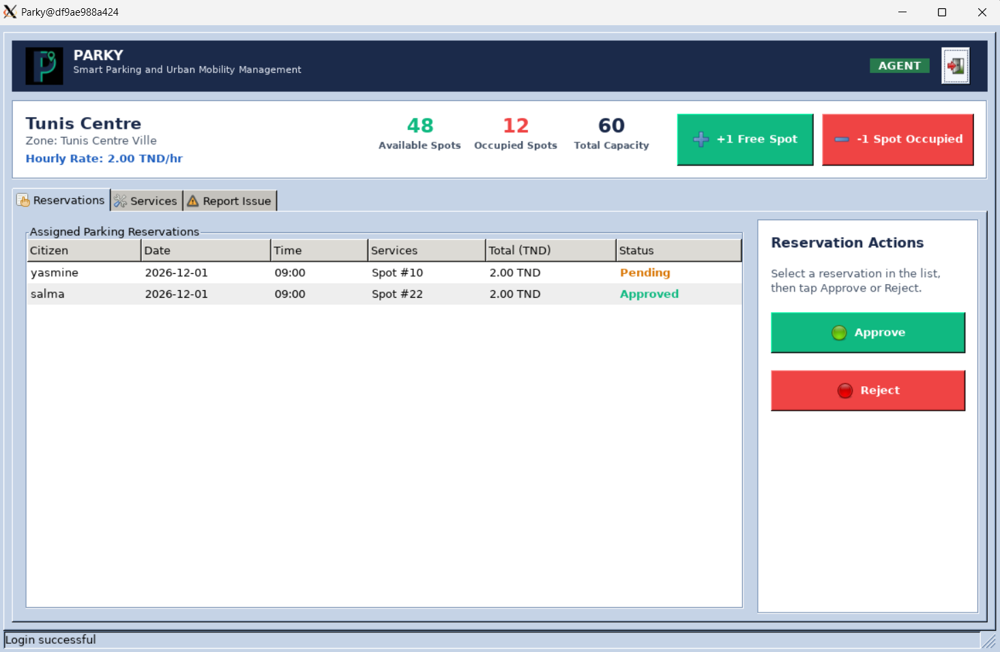

<p align="center">
  
</p>

<h1 align="center">Parky</h1>

<p align="center">
  <strong>A desktop parking &amp; urban mobility management system built in pure C with GTK+&nbsp;2 —<br>
  find, reserve, and manage urban parking spaces across three role-based dashboards.</strong>
</p>

<p align="center">
  
  
  
  
  
</p>

---

## Visual Preview

| Login · Live Password Strength | Admin Analytics & CRUD |
|:---:|:---:|
|  |  |
| **Agent Real-Time Spot Management** | **Citizen Search, Booking & Tariff** |
|  |  |

---

## Core Features

### Admin Dashboard
- Five real-time KPI cards updated every **2 seconds**: Total Users, Total Parkings, Parking Agents, Pending Complaints, and global Occupancy Rate.
- Separate management panels for Citizens and Parking Agents, each with Add / Edit / Delete actions in a compact 2×2 button grid.
- Full Parking CRUD (name, address, total spots, available spots) and one-click agent-to-parking assignment.
- Complaint inbox with detail view, resolve, and delete actions; live Occupancy & Revenue summary table.

### Parking Agent Dashboard
- Color-coded hero card showing assigned parking name, zone, hourly rate, and three live spot counters (Available · Occupied · Total Capacity).
- **+1 Free Spot** / **−1 Occupied** controls with immediate `data/*.txt` persistence and cross-dashboard sync.
- Reservation table with Approve / Reject actions; status changes reflect in the Citizen dashboard within 2 seconds.
- Service catalog management (Add, Edit, Toggle active/inactive, Delete) with TND pricing.
- Issue reporting form forwarded directly to the Admin complaint inbox.

### Citizen Dashboard
- Multi-criteria live search: filter by parking name, address, and availability — results update on every keystroke with an inline `N matched` badge.
- **Calendar picker** (`GtkCalendar` modal, pre-filled with today's date) and **clock spinners** (Hour 0–23, Minute 0–55 step 5) replace raw text inputs in the booking form.
- Booking card shows the selected parking name, optional spot number, extra service dropdown (populated dynamically from the active service catalog), and a live **TND tariff estimate**.
- Single **Confirm Booking** button reserves the spot and optionally attaches a service in one action.
- My Reservations table: Parking Name, Spot, Date, Time, Total TND, color-coded Status — with **Cancel Reservation** (Pending only, requires confirmation) and 2-second real-time sync.
- Reviews & Complaints tab: three equal-width columns — Submit Review (parking dropdown, 1–5 star spinner, comment), Report Complaint (subject + description), and Community Reviews table.

### Security & UX
- **Strong password enforcement** on registration: ≥ 8 characters containing at least one uppercase letter, one lowercase letter, and one digit.
- **Live strength meter** on the Sign-Up card: an 8 px `GtkProgressBar` and a Pango hint label transition Weak → Medium → Strong in real time as the user types, before the form is submitted.
- Strict input sanitization: pipe `|` and whitespace delimiters rejected from all stored fields.
- Uniform `#1B2A4A` navy header, `#C5D3E6` slate background, and consistent role-colored badges across all three dashboards at a fixed **1180 × 740** window.

---

## Project Structure

```
parky/
├── src/
│   ├── main.c          Entry point — storage init, ui_run()
│   ├── ui.c            Entire GTK+ 2 UI (login, admin, agent, citizen views)
│   ├── admin.c         Admin CRUD logic
│   ├── agent.c         Agent reservation & service logic
│   ├── citoyen.c       Citizen registration, filtering, booking, reviews
│   └── storage.c       Plain-text .txt serialization / deserialization
├── include/
│   ├── models.h        Shared structs: User, Parking, Reservation, Service, Review, Complaint
│   ├── admin.h / agent.h / citoyen.h / storage.h / ui.h
├── data/               Versioned demo .txt fixtures (auto-generated on first run)
├── assets/             logo.jpg
├── docs/               Screenshots (place screen-*.png here)
├── Dockerfile          Ubuntu 18.04 + libgtk2.0-dev + Glade 2.12.2 from source
├── docker-compose.yml  X11 volume mount for WSLg / Linux GUI forwarding
└── Makefile            gcc -Wall -Wextra, single-command build
```

---

## Quick Start

### Prerequisites

Parky requires a GTK+ 2 display environment. The Docker image bundles everything; no local GTK install is needed on the host.

### Option A — Docker + GUI (Recommended)

#### Windows (WSLg or VcXsrv / XLaunch)

1. Install [VcXsrv](https://sourceforge.net/projects/vcxsrv/) and launch **XLaunch** with  
   *Multiple windows* → *Start no client* → tick **Disable access control** → Finish.

2. Find your host IP (`ipconfig`, look for the WSL adapter, e.g. `172.x.x.x`).

3. Build the image (first run takes a few minutes — Glade 2.12.2 compiles from source):
   ```bash
   docker compose build
   ```

4. Run:
   ```bash
   DISPLAY=<host-ip>:0.0 docker compose run --rm parky bash -c "make && ./parky"
   ```
   Or set `DISPLAY` inside `docker-compose.yml` and simply run:
   ```bash
   docker compose run --rm parky bash -c "make && ./parky"
   ```

#### Linux

```bash
xhost +local:docker
docker compose run --rm parky bash -c "make && ./parky"
```

### Option B — Native Build (Linux with GTK+ 2)

```bash
sudo apt-get install gcc libgtk2.0-dev pkg-config
make
./parky
```

---

## Demo Credentials

The `data/*.txt` fixture files are intentionally committed for **v1.0.0** so evaluators can open the application and explore all three role dashboards immediately without any setup. On the first run with an empty `data/` directory the application auto-generates the same fixtures via `generate_demo_data()`.

| Role | Email | Password |
|---|---|---|
| Admin | `admin@parky.local` | `admin` |
| Parking Agent | `sami@parky.tn` | `agent123` |
| Parking Agent | `nadia@parky.tn` | `agent123` |
| Citizen | `yasmine@demo.tn` | `citizen123` |
| Citizen | `karim@demo.tn` | `citizen123` |

> **Note:** These passwords intentionally do not meet the new strong-password policy, which applies only to **new registrations** via the Sign-Up form. Existing seeded accounts sign in normally.

The demo dataset includes **12 parking lots**, **5 agents**, **8 citizens**, **18 reservations** (Pending / Approved / Completed / Rejected), **6 services**, **10 reviews**, and **8 complaints**.

---

## Data Model

```
ParkyData (static arrays, all fits in a single stack-allocated struct)
│
├── User[100]          id · name · password · email · role · assignedParkingId · avatarPath
├── Parking[50]        id · name · address · totalSpots · availableSpots · status
├── Reservation[200]   id · citizenId · parkingId · date · time · spotNumber · status
├── Service[100]       id · name · description · price · status
├── Review[200]        id · citizenId · parkingId · rating · comment
└── Complaint[200]     id · citizenId · subject · description · status
```

Persistence is **plain-text whitespace-delimited `.txt` files** (`data/users.txt`, `data/parkings.txt`, …), read and written by `storage_load()` / `storage_save()` via `fscanf` / `fprintf`. Every mutation (booking, spot adjustment, complaint, service edit) calls `storage_save()` immediately, so no data is held exclusively in memory.

---

## Engineering Trade-offs — v1.0.0 vs v2.0.0

### v1.0.0 — Auditable Baseline (this release)

| Decision | Rationale |
|---|---|
| Plain-text `.txt` persistence | Human-readable, diff-friendly, zero external dependencies. Any evaluator can inspect or edit data with a text editor. |
| Static arrays with O(n) linear scans | Straightforward to audit and reason about; array sizes are generous enough for a demo dataset and the target scope. |
| Single-translation-unit UI (`ui.c`) | All GTK+ 2 widget construction in one file makes the codebase self-contained and easy to follow top-to-bottom. |
| Demo fixtures committed to git | Evaluators can run all three dashboards immediately without a seed script or migration step. |

### v2.0.0 — Planned Refactor

| Area | Plan |
|---|---|
| **Persistence** | Binary `.dat` serialization via `fwrite`/`fread` for compact, versioned storage with a file-header magic number and schema version field. |
| **Data structures** | Replace static arrays with heap-allocated singly-linked lists for Users, Parkings, and Reservations; O(1) append, O(n) search, `free()`-safe teardown. |
| **Memory safety** | `valgrind --leak-check=full` clean; replace all `strcpy` with `snprintf`-bounded copies; introduce a dedicated `parky_free(ParkyData *)` teardown. |
| **Modular UI** | Split `ui.c` into per-role translation units (`ui_admin.c`, `ui_agent.c`, `ui_citizen.c`) with a shared `ui_common.c`. |
| **CI/CD** | Jenkins pipeline: `gcc -Wall -Wextra` build gate → `cppcheck` static analysis → SonarQube quality gate (zero critical issues) → Docker image publish. |

---

## License

MIT © 2026 Amine Maalej — see [LICENSE](LICENSE).
