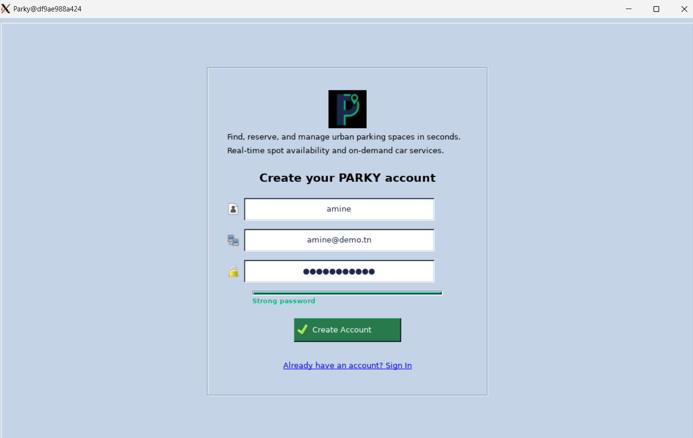
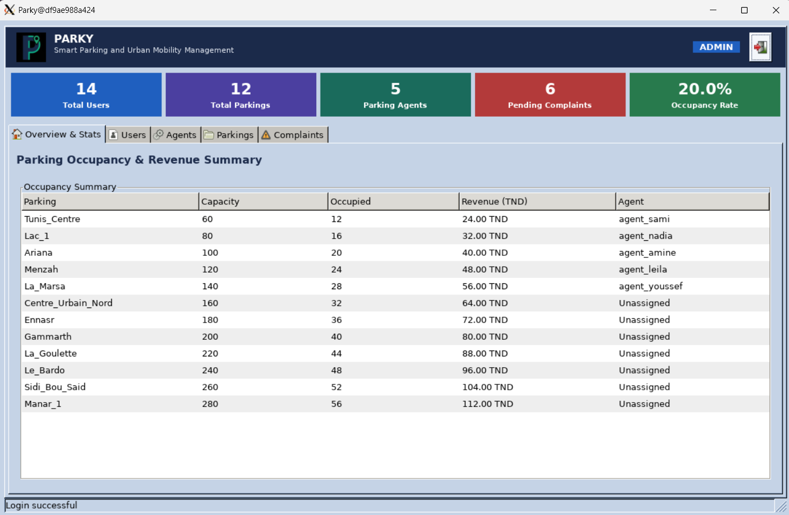
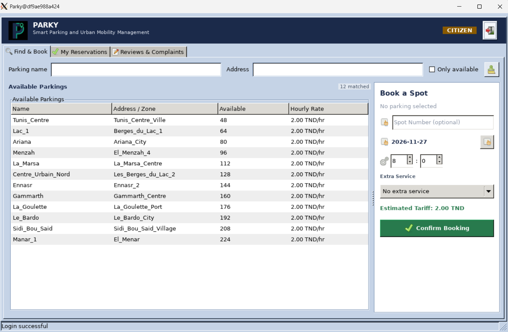
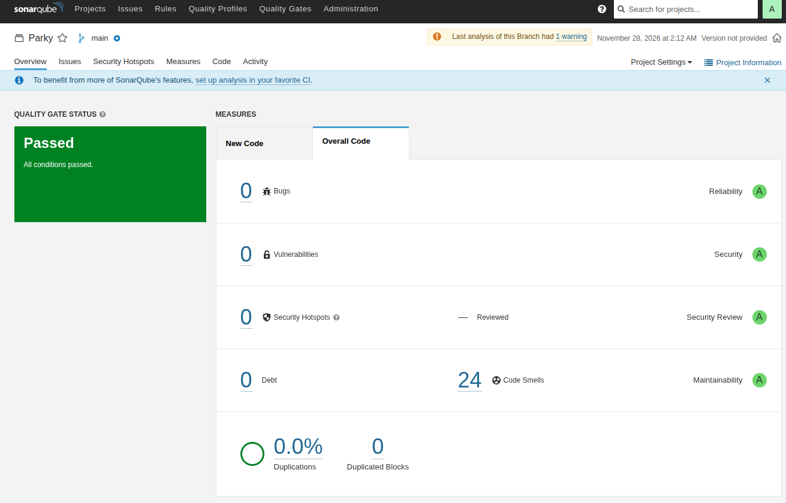
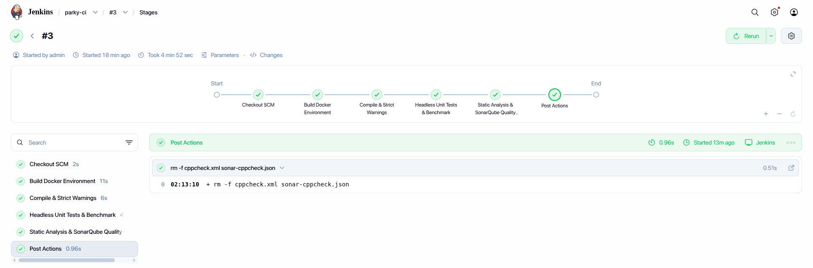

<p align="center">
  
</p>

<h1 align="center">Parky</h1>

<p align="center">
  <strong>v2.0.0 · A systems and DevOps portfolio project built in C with GTK+&nbsp;2 —<br>
  find, reserve, and manage urban parking spaces across three role-based dashboards.</strong>
</p>

<p align="center">
  
  
  
  
  
  
  
</p>

---

## Visual Preview

| Login · Live Password Strength | Admin Analytics & CRUD |
|:---:|:---:|
|  |  |
| **Agent Real-Time Spot Management** | **Citizen Search, Booking & Tariff** |
|  |  |

---

## Core Features

### Admin Dashboard
- Five real-time KPI cards updated every **2 seconds**: Total Users, Total Parkings, Parking Agents, Pending Complaints, and global Occupancy Rate.
- Separate management panels for Citizens and Parking Agents, each with Add / Edit / Delete actions in a compact 2×2 button grid.
- Full Parking CRUD (name, address, total spots, available spots) and one-click agent-to-parking assignment.
- Complaint inbox with detail view, resolve, and delete actions; live Occupancy & Revenue summary table.

### Parking Agent Dashboard
- Color-coded hero card showing assigned parking name, zone, hourly rate, and three live spot counters (Available · Occupied · Total Capacity).
- **+1 Free Spot** / **−1 Occupied** controls with immediate binary `data/*.dat` persistence and cross-dashboard sync.
- Reservation table with Approve / Reject actions; status changes reflect in the Citizen dashboard within 2 seconds.
- Service catalog management (Add, Edit, Toggle active/inactive, Delete) with TND pricing.
- Issue reporting form forwarded directly to the Admin complaint inbox.

### Citizen Dashboard
- Multi-criteria live search: filter by parking name, address, and availability — results update on every keystroke with an inline `N matched` badge.
- **Calendar picker** (`GtkCalendar` modal, pre-filled with today's date) and **clock spinners** (Hour 0–23, Minute 0–55 step 5) replace raw text inputs in the booking form.
- Booking card shows the selected parking name, optional spot number, extra service dropdown (populated dynamically from the active service catalog), and a live **TND tariff estimate**.
- Single **Confirm Booking** button reserves the spot and optionally attaches a service in one action.
- My Reservations table: Parking Name, Spot, Date, Time, Total TND, color-coded Status — with **Cancel Reservation** (Pending only, requires confirmation) and 2-second real-time sync.
- Reviews & Complaints tab: three equal-width columns — Submit Review (parking dropdown, 1–5 star spinner, comment), Report Complaint (subject + description), and Community Reviews table.

### Security & UX
- **Strong password enforcement** on registration: ≥ 8 characters containing at least one uppercase letter, one lowercase letter, and one digit.
- **Live strength meter** on the Sign-Up card: an 8 px `GtkProgressBar` and a Pango hint label transition Weak → Medium → Strong in real time as the user types, before the form is submitted.
- Strict input sanitization: pipe `|` and whitespace delimiters rejected from all stored fields.
- Uniform `#1B2A4A` navy header, `#C5D3E6` slate background, and consistent role-colored badges across all three dashboards at a fixed **1180 × 740** window.

---

## Project Structure

```
parky/
├── src/
│   ├── main.c          Entry point — storage init, ui_run()
│   ├── ui.c            Entire GTK+ 2 UI (login, admin, agent, citizen views)
│   ├── admin.c         Admin CRUD logic
│   ├── agent.c         Agent reservation & service logic
│   ├── citoyen.c       Citizen registration, filtering, booking, reviews
│   └── storage.c       PKY2 binary .dat serialization and legacy .txt migration
├── include/
│   ├── models.h        Shared structs: User, Parking, Reservation, Service, Review, Complaint
│   ├── admin.h / agent.h / citoyen.h / storage.h / ui.h
├── tests/
│   ├── test_suite.c    Headless C tests for storage and role workflows
│   └── benchmark.c     ASCII .txt vs binary .dat I/O benchmark
├── data/               Runtime .dat files; legacy .txt files migrate automatically
├── assets/             logo.jpg
├── docs/               UI, Jenkins pipeline, and SonarQube quality gate screenshots
├── Dockerfile          Ubuntu 18.04 + libgtk2.0-dev + Glade 2.12.2 from source
├── docker-compose.yml  X11 volume mount for WSLg / Linux GUI forwarding
├── Jenkinsfile         Docker build, strict compile, tests, cppcheck, SonarQube gate
├── sonar-project.properties  SonarQube project and external issue report settings
└── Makefile            C99 build plus headless `make test` and `make bench`
```

---

## Quick Start

### Prerequisites

Parky requires a GTK+ 2 display environment. The Docker image bundles everything; no local GTK install is needed on the host.

### Option A — Docker + GUI (Recommended)

#### Windows (WSLg or VcXsrv / XLaunch)

1. Install [VcXsrv](https://sourceforge.net/projects/vcxsrv/) and launch **XLaunch** with  
   *Multiple windows* → *Start no client* → tick **Disable access control** → Finish.

2. Find your host IP (`ipconfig`, look for the WSL adapter, e.g. `172.x.x.x`).

3. Build the image (first run takes a few minutes — Glade 2.12.2 compiles from source):
   ```bash
   docker compose build
   ```

4. Run:
   ```bash
   DISPLAY=<host-ip>:0.0 docker compose run --rm parky bash -c "make && ./parky"
   ```
   Or set `DISPLAY` inside `docker-compose.yml` and simply run:
   ```bash
   docker compose run --rm parky bash -c "make && ./parky"
   ```

#### Linux

```bash
xhost +local:docker
docker compose run --rm parky bash -c "make && ./parky"
```

### Option B — Native Build (Linux with GTK+ 2)

```bash
sudo apt-get install gcc libgtk2.0-dev pkg-config
make
./parky
```

---

## Demo Credentials

On first run, Parky creates a demo dataset and stores it in binary `data/*.dat` files. Existing v1 `data/*.txt` records are imported automatically when no binary files exist. Seeded account credentials are listed below; they do not meet the strong-password policy, which applies to new registrations.

| Role | Email | Password |
|---|---|---|
| Admin | `admin@parky.local` | `admin` |
| Parking Agent | `sami@parky.tn` | `agent123` |
| Parking Agent | `nadia@parky.tn` | `agent123` |
| Citizen | `yasmine@demo.tn` | `citizen123` |
| Citizen | `karim@demo.tn` | `citizen123` |

> **Note:** These passwords intentionally do not meet the new strong-password policy, which applies only to **new registrations** via the Sign-Up form. Existing seeded accounts sign in normally.

The generated demo dataset includes **12 parking lots**, **5 agents**, **8 citizens**, **18 reservations** (Pending / Approved / Completed / Rejected), **6 services**, **10 reviews**, and **8 complaints**.

---

## Data Model

```
ParkyData (heap-allocated collections with tracked counts and capacities)
│
├── User[]          id · name · password · email · role · assignedParkingId · avatarPath
├── Parking[]       id · name · address · totalSpots · availableSpots · status
├── Reservation[]   id · citizenId · parkingId · date · time · spotNumber · status
├── Service[]       id · name · description · price · status
├── Review[]        id · citizenId · parkingId · rating · comment
└── Complaint[]     id · citizenId · subject · description · status
```

Each collection grows on the heap and tracks its current count and capacity. `storage_cleanup()` releases all collection buffers at application exit. Persistence uses six versioned binary files (`data/users.dat`, `data/parkings.dat`, and others) written and read with `fwrite` and `fread`. Each file has a `PKY2` magic header, format version, and record count. When a v2 binary store is not present, `storage_init()` imports legacy v1 text records and saves them in binary format.

## Architecture Evolution: v1.0.0 → v2.0.0

| Area | v1.0.0 | v2.0.0 |
|---|---|---|
| **Persistence** | Whitespace-delimited ASCII `.txt` files | Binary `.dat` files with `PKY2` magic header, version and record count; automatic one-time import of legacy text data |
| **Memory management** | Fixed-size static arrays (`MAX_*`) | Heap-allocated, resizable collections with tracked counts and capacities; `malloc`/`realloc`/`free` and `storage_cleanup()` |
| **Testing & QA** | Manual GUI testing | 22 headless C checks via `make test`, serialization benchmark via `make bench`, and `cppcheck` issues imported through SonarQube's native Generic Issue Data format |

## I/O Benchmark Results

Serialization measurements for **5,000 parking and 5,000 reservation records**:

| Format | Serialization time | Combined file size |
|---|---:|---:|
| ASCII `.txt` | 2.68 ms | 466 KB |
| Binary `.dat` | 1.07 ms (**2.5× faster I/O**) | 1.78 MB |

The binary format writes fixed-size C structs directly, avoiding text parsing and formatting. That delivers higher throughput, but each record includes fixed-width character arrays and struct padding even when most bytes are unused. The text format stores only the characters and delimiters needed for each value, so it is more compact while requiring conversion during reads and writes. These figures show the measured speed-versus-size trade-off for this dataset.

## CI/CD & Code Quality

The declarative Jenkins pipeline uses the local Linux agent's Docker daemon to build `parky-ci:latest`; it does not require Docker-in-Docker. The pipeline compiles with `-Wall -Wextra`, runs the headless unit suite and benchmark, then runs `cppcheck` with warning, style, performance, and portability checks. An inline Python converter maps cppcheck XML findings to SonarQube's built-in Generic Issue Data JSON format, so the import does not require a third-party plugin.

The SonarScanner container connects to the configured `SONAR_HOST_URL` over host networking, authenticates with the Jenkins `SONAR_TOKEN` credential, and waits for the quality gate. The displayed gate snapshot reports **0 Bugs, 0 Vulnerabilities, and 0.0% Duplications**.





---

## License

MIT © 2026 Amine Maalej — see [LICENSE](LICENSE).
